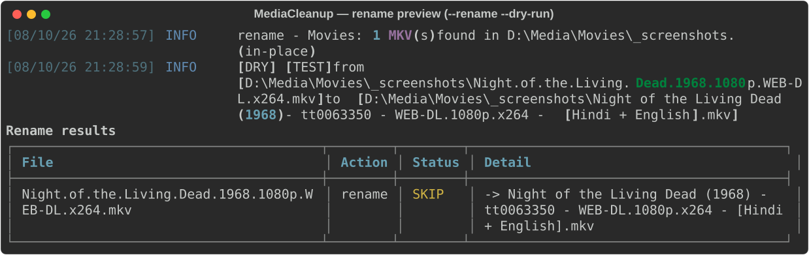
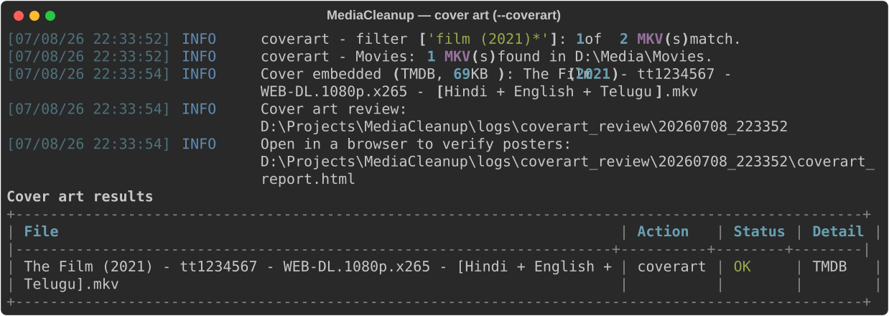
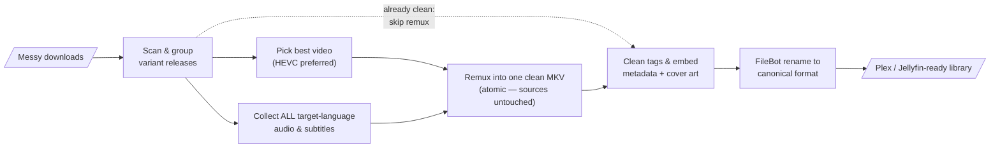

# MediaCleanup


Windows MKV media cleanup, merge, and tagging tool built on **MKVToolNix**, with optional **FileBot** renaming and **cover art** embedding.

For **movies**: scans a folder, groups variant releases of the same movie (e.g. a Telugu release + a Hindi/English release), selects the best video track (HEVC preferred), collects **all audio tracks in your target languages** from every variant (configurable — default Hindi/English/Telugu, ~40 languages supported), keeps target-language subtitles, and merges everything into one clean MKV. Every processed file is fully finished in one run: tags cleaned, metadata + cover art embedded, renamed via FileBot.

For **TV**: applies the same track selection and tag cleaning to each episode file.

Plus two standalone maintenance modes:

- `--cleantags` — strip promotional/watermark tags, attachments, and junk track names in-place, no remux.
- `--coverart` — fetch movie/show posters (TMDB → fanart.tv → OMDb, or a local `poster.jpg`) and embed them as MKV cover art.
- `--rename` — FileBot-rename messy downloads into a canonical format, with full undo.
- `--subtitles` — download missing subtitles from OpenSubtitles as sidecar `.srt` files.

## In action

Rename messy downloads with a safe preview first — real database lookups, exact proposed names:



Embed cover art across the library — every poster audited in an HTML review gallery:



Verify your API keys before spending any quota:


## How it works



## Requirements

| Requirement | Notes |
|---|---|
| Windows 10/11 | Uses Windows long-path handling; paths are Windows-style |
| Python 3.11+ | Standard library only — no pip installs required |
| [MKVToolNix](https://mkvtoolnix.download/) | `mkvmerge` + `mkvpropedit` (+ `mkvextract` for IMDB tag reads) |
| [FileBot](https://www.filebot.net/) | *Optional* — canonical renaming via TheMovieDB/TheTVDB |
| [rich](https://pypi.org/project/rich/) | *Optional (recommended)* — colored output + summary tables (`pip install rich`) |
| [Pillow](https://pypi.org/project/pillow/) | *Optional* — downscales oversized local posters for `--coverart` |

## Folder layout

Runtime tools live inside the project — drop them into the committed skeleton and the default config finds them automatically (relative paths resolve against the script folder). See [runtimes/README.md](runtimes/README.md) for details.

```
MediaCleanup\
├── MediaCleanup.py              ← the tool
├── MediaCleanup.example.toml    ← copy to MediaCleanup.toml and edit
├── MediaCleanup.toml            ← your config + API keys (git-ignored)
├── runtimes\                    ← portable tools (binaries git-ignored)
│   ├── mkvtoolnix\              ←   REQUIRED: extract MKVToolNix portable here
│   └── FileBot\                 ←   OPTIONAL: portable FileBot here
├── logs\                        ← rename history, cover art ledger + reviews (auto-created)
└── docs\                        ← usage & configuration guides
```

## Quick start

```bat
:: 1. Get the code
git clone https://github.com/atikansari-ghr/MediaCleanup.git && cd MediaCleanup

:: 2. Drop MKVToolNix (portable) into runtimes\mkvtoolnix
::    https://mkvtoolnix.download/downloads.html#windows

:: 3. Create your config (git-ignored; holds your paths + API keys)
copy MediaCleanup.example.toml MediaCleanup.toml
notepad MediaCleanup.toml

:: 4. Validate tools and folders
python MediaCleanup.py --self-check

:: 5. Preview what would happen (nothing is written)
python MediaCleanup.py --dry-run --verbose

:: 6. Run
python MediaCleanup.py
```

## Common commands

```bat
python MediaCleanup.py --movies                          :: movies only
python MediaCleanup.py --tv                              :: TV only
python MediaCleanup.py --movies --input "D:\Downloads"   :: specific folder
python MediaCleanup.py --audio-langs Telugu Hindi        :: keep only these languages
python MediaCleanup.py --cleantags                       :: clean tags in-place, no remux
python MediaCleanup.py --coverart                        :: embed cover art in-place
python MediaCleanup.py --rename --movies --input "D:\Downloads"  :: FileBot-rename downloads
python MediaCleanup.py --subtitles                       :: download missing sidecar subs
python MediaCleanup.py --validate-keys                   :: test all configured API keys
python MediaCleanup.py --tv --force-audio-lang 1 Hindi   :: fix "und" mislabeled tracks
```

## Output naming

```
Movies:  The Film (2021) - tt1234567 - WEB-DL.1080p.x265 - [Hindi + English + Telugu].mkv
TV:      Show Name (2008) - S01E01 - Pilot - 1080p.x265 - [English].mkv
```

## Safety model

- Source files are copied to a working folder before any remux; originals are untouched by the remux path.
- Output is written to a `.tmp` file, then atomically renamed into place.
- `--dry-run` previews every action, including mkvmerge command lines, without writing anything.
- In-place modes (`--cleantags`, `--coverart`, and the skip-remux fast path) edit metadata/attachments only — never the media streams.

## Documentation

| Document | Contents |
|---|---|
| [docs/USAGE.md](docs/USAGE.md) | Full usage guide — every flag, workflows, recipes, troubleshooting |
| [docs/CONFIGURATION.md](docs/CONFIGURATION.md) | Every `MediaCleanup.toml` key explained |

## License

[MIT](LICENSE) — free to use, modify, and share.
