<div align="center">

# 🎞️ MediaCleanup

**Clean, merge, tag and name your MKV library — and never guess a title.**


[](https://github.com/atikansari-ghr/MediaCleanup/actions/workflows/ci.yml)
[](SECURITY.md)

[**Quick start**](#-quick-start) · [**How it works**](#-how-it-works) · [**Commands**](#-which-command-do-i-need) · [**Usage guide**](docs/USAGE.md) · [**Configuration**](docs/CONFIGURATION.md) · [**Changelog**](CHANGELOG.md)

<br>

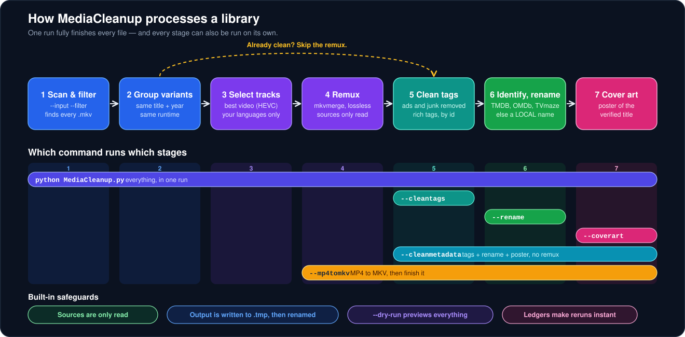

</div>

<br>

Windows MKV media tool built on **MKVToolNix**, with optional **FileBot** renaming and **cover art** embedding. Point it at a folder; it hands back a library that Plex, Jellyfin, Kodi and VLC all read the same way.

> [!TIP]
> New here? Run `python MediaCleanup.py --dry-run --verbose` first. Every mode previews exactly what it would do — names, tags, commands — and writes nothing.

## ✨ What it does

| | | |
|---|---|---|
| 🎬 **Movies** | Groups variant releases of one film (say a Telugu release and a Hindi/English one), picks the best video (HEVC preferred), gathers **every audio track in your target languages** from all variants, keeps matching subtitles, and merges it all into one clean MKV. | Default targets are Hindi, English and Telugu. Any ISO 639 language works. |
| 📺 **TV** | The same track selection and tag cleaning, applied to each episode. | Renewed shows are handled: a later season's year is not the show's debut year. |
| 🏷️ **Tags** | Strips promotional tags and advertising attachments, writes a clean title, and embeds genre, director, cast, synopsis and ratings **by verified id**. | Never from a title search that could return another film. |
| 🖼️ **Cover art** | Embeds a poster of the verified title (TMDB → fanart.tv → OMDb, or your own `poster.jpg`) with an HTML review gallery. | An unidentified title keeps whatever cover it has. |
| 🧭 **Identification** | A title is identified **before** it is renamed, through several databases, and refused when it is ambiguous. | New in 1.11: OMDb for films, TVmaze for shows. |
| 🛟 **LOCAL names** | A title no database knows is named from facts in its own file instead of keeping its release name. | Reported separately as `LOCAL`; nothing is invented. |
| 🔤 **Languages** | Works out what `und` tracks really are: audio from the title's original language, subtitles from their own text. | 42 of 42 correct on a 42-language test release. |
| 📦 **MP4 → MKV** | Lossless remux with sidecar `.srt`, advertising cues removed, forced-subtitle detection, then the full finishing chain. | Your `.mp4` and `.srt` are never touched. |

Plus standalone maintenance modes, each runnable on its own:

| Mode | What it does |
|---|---|
| `--cleantags` | Strip junk tags, ad attachments and track names in place — no remux — and embed full metadata when API keys are set. |
| `--coverart` | Fetch and embed posters, with an HTML review gallery. |
| `--cleanmetadata` | `--cleantags` and `--coverart` in one command. With `--clear`, wipe tags **and** covers and never rename. |
| `--rename` | FileBot-rename messy filenames into a canonical format, with full undo. |
| `--mp4tomkv` | Convert MP4/M4V into finished MKVs beside the source. |
| `--subtitles` | Download missing subtitles from OpenSubtitles as sidecar `.srt` files. |
| `--clear` | Removal modifier: wipe all tags, or remove embedded cover art. |

## 🚀 Quick start

### One command

```powershell
irm https://github.com/atikansari-ghr/MediaCleanup/releases/latest/download/install.ps1 | iex
```

The installer finds or installs Python, unpacks the release, verifies every file against the hashes GitHub published for it, fetches MKVToolNix (checksum-verified), writes a first config from your answers and creates a launcher. Prefer to read it first? Download `install.ps1` from the release and run `powershell -ExecutionPolicy Bypass -File .\install.ps1`. It needs no account, no token and no administrator rights. See [the installer](docs/USAGE.md#the-installer) for every option.

### By hand

```bat
:: 1. Get the code
git clone https://github.com/atikansari-ghr/MediaCleanup.git && cd MediaCleanup

:: 2. Drop MKVToolNix (portable) into runtimes\mkvtoolnix
::    https://mkvtoolnix.download/downloads.html#windows

:: 3. Create your config (git-ignored; holds your paths + API keys)
copy MediaCleanup.example.toml MediaCleanup.toml
notepad MediaCleanup.toml

:: 4. Validate tools and folders
python MediaCleanup.py --self-check

:: 5. Preview what would happen (nothing is written)
python MediaCleanup.py --dry-run --verbose

:: 6. Run
python MediaCleanup.py
```

> [!NOTE]
> All paths and API keys live in `MediaCleanup.toml`. The script has no hardcoded locations, and relative paths resolve against the script folder, so a cloned project with tools in `runtimes\` works wherever it sits.

## 🧩 How it works

One run fully finishes every file. The pipeline above has seven stages; a file that is already clean skips the remux, and every stage after the remux can also be run on its own with the modes in the table.

### Identification — nothing is guessed

The step that decides what a file **is** gets the most care, because a wrong answer would be written into the filename, the tags and the poster, and every later run would trust it.

<div align="center">
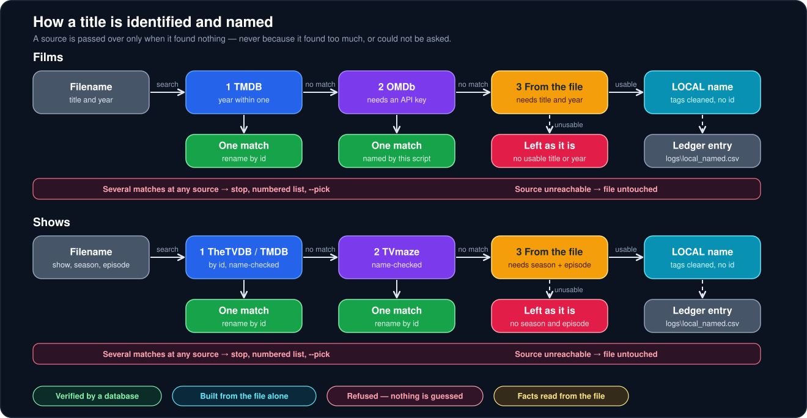
</div>

| Rule | Why |
|---|---|
| 🔵 **A source is passed over only when it found nothing.** | If TMDB finds three films with the same name, asking OMDb would only add more guesses. |
| 🟢 **Every hit is verified.** | Exact title (or whole-word prefix), year within one for films, series name for shows. A near miss is "nothing found". |
| 🔴 **Several matches stop the run for that title.** | The file is left alone and the candidates are numbered. You choose with `--pick N`. |
| 🟠 **An unreachable database is not "nothing found".** | A network outage or bad key leaves the file untouched; it never triggers a rename. |
| 🟣 **A title found nowhere is named from its own file.** | `Movie (2023) - WebRip.1080p.x264 - [Hindi + English].mkv`, reported `LOCAL`, with no id, poster or description added. |

### Reading the results

Every run ends with a summary table. The status column tells you exactly what happened to each file:

| Status | Meaning |
|---|---|
| 🟢 **OK** | Processed, and renamed from a verified database match. |
| 🔵 **LOCAL** | No database knows the title. Named and tag-cleaned from the file alone; listed in `logs\local_named.csv`. |
| 🟡 **PARTIAL** | Processed, but **not renamed** — several titles share the name (pick one), or the rename failed. The reason is shown. |
| ⚪ **SKIP** | Nothing to do: already covered, already named, or a film too ambiguous to give a poster. |
| 🔴 **FAIL** | Something went wrong. The reason is shown, and the sources are untouched. |

### Choosing between ambiguous titles

```bat
python MediaCleanup.py --movies --dry-run        :: lists numbered candidates, writes nothing
python MediaCleanup.py --movies --pick 2 3       :: resolve titles 2 and 3, films and shows alike
```

The numbers are saved to `logs\pending_identity.csv` and read back, never recomputed, so a number always means the title you were shown.

## 🔄 Install, update and repair

<div align="center">
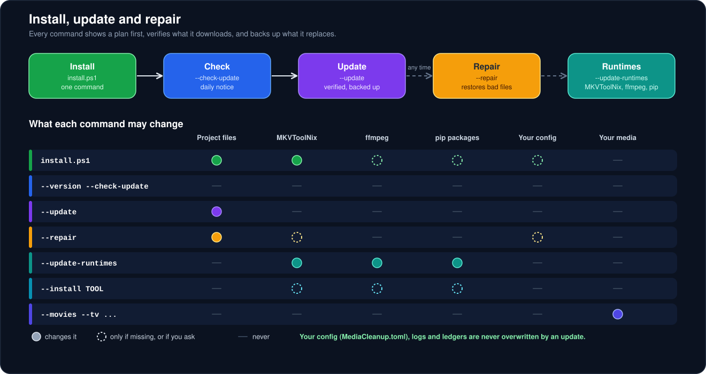
</div>

The tool looks after itself. `--check-update` compares your version with the latest release (a one-line notice also appears at the end of a run, at most once a day, never delaying it); `--update` installs it with **every file verified against GitHub's published hashes**, a backup of whatever it replaces, and automatic rollback if anything fails; `--repair` restores a damaged install; `--update-runtimes` keeps MKVToolNix, ffmpeg and the pip packages current. Your `MediaCleanup.toml`, `logs\` and ledgers are **never** touched. Details in the [usage guide](docs/USAGE.md#installing-updating-and-repairing).

## 🧭 Which command do I need?

| I want to… | Run |
|---|---|
| Process everything and finish every file | `python MediaCleanup.py` |
| Only movies, or only TV | `--movies` · `--tv` |
| Work on one folder | `--movies --input "D:\Downloads"` |
| Only titles starting with A | `--movies --filter "A*"` |
| Replace the sources, keep a safety copy | `--movies --inplace --backup` |
| Keep only some audio languages this run | `--audio-langs Telugu Hindi` |
| Clean tags and add metadata, no remux | `--cleantags` |
| Add posters everywhere | `--coverart` |
| Tags + metadata + rename + poster, no remux | `--cleanmetadata` |
| Wipe tags and covers, never rename | `--cleanmetadata --clear` |
| Rename messy filenames | `--rename --movies --input "D:\Downloads"` |
| Undo the last rename batch | `--rename-undo` |
| Convert MP4 (+ `.srt`) to finished MKV | `--mp4tomkv --movies` |
| Fetch missing subtitles | `--subtitles` |
| Fix mislabelled `und` tracks | `--tv --force-audio-lang 1 Hindi` |
| Leave unknown titles exactly as they are | `--no-local-name` |
| Test all my API keys | `--validate-keys` |
| See my version and tool versions | `--version` |
| Check for a newer release | `--check-update` |
| Install the newest release (verified, with rollback) | `--update` |
| Fix a damaged install | `--repair` |
| Update MKVToolNix, ffmpeg and the pip packages | `--update-runtimes` |
| Add an optional tool (ffmpeg, rich, Pillow) | `--install ffmpeg` |

Every mode supports `--dry-run` to preview and `--filter` / `--input` to scope the run.

## 🔎 In action

Every screenshot below is the tool's real output (the same code and commands you run), shown on a public-domain film or on placeholder titles.

### Day to day

Rename messy filenames with a safe preview first — real database lookups, exact proposed names:


Every run ends with a summary that says exactly what happened to each file — `OK`, `LOCAL`, `PARTIAL`, `SKIP` or `FAIL`:

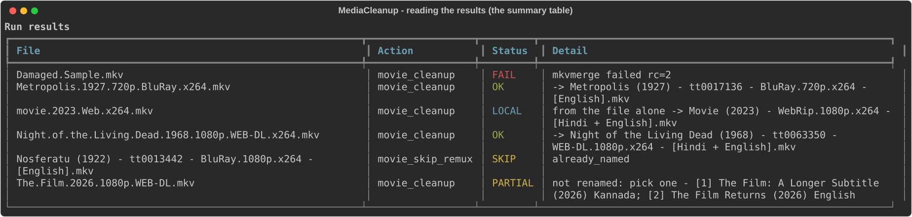

When several titles share a name, nothing is guessed: you get a numbered list and pick with `--pick`:

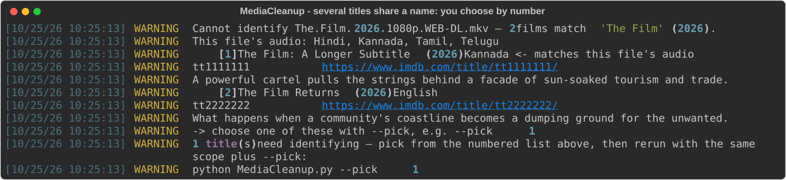

Embed cover art across the library — every poster audited in an HTML review gallery:


### Subtitles

A subtitle is checked against your video's length; one that does not fit is discarded and the next-best candidate is tried once:

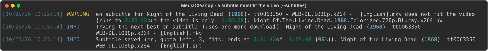

### Keeping it healthy

Verify your API keys before spending any quota:


See what you are running:

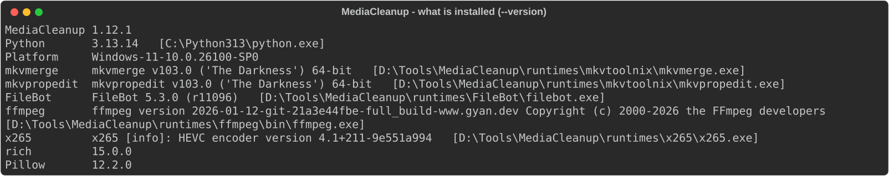

Find out whether a newer release exists, and what changed:

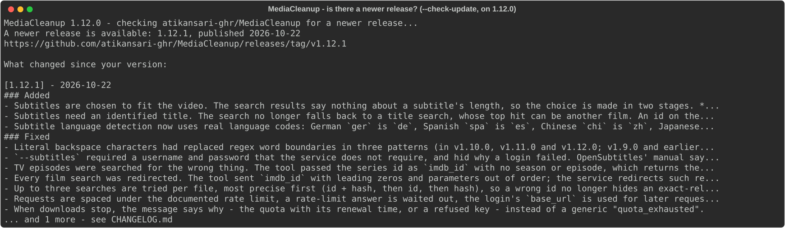

See exactly what an update would change before it touches anything:

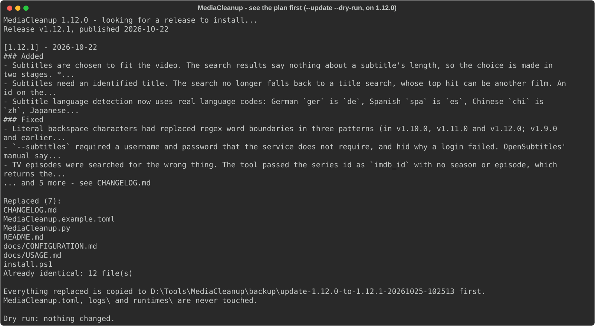

Fix a damaged install without touching your config or logs:

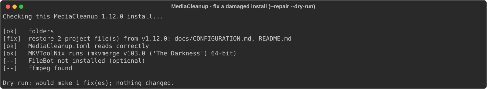

Keep MKVToolNix, ffmpeg and the pip packages current, and see what is only reported:

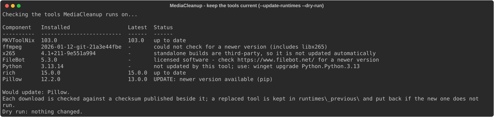

## 🏷️ Output naming

```
Movie:        Night of the Living Dead (1968) - tt0063350 - WEB-DL.1080p.x264 - [Hindi + English].mkv
Episode:      Show Name (2019) - S01E01 - Episode Title - 1080p.x265 - [English].mkv
LOCAL film:   Movie (2023) - WebRip.1080p.x264 - [Hindi + English].mkv            (no database knew it)
LOCAL show:   Show Name - S01E02 - 1080p.x264 - [English].mkv                     (no database knew it)
```

## 🛡️ Safety model

> [!IMPORTANT]
> Remux inputs are only ever **read**. Output is built elsewhere and your originals stay untouched — unless you opt into `--inplace`, which verifies the output (track counts and duration) before any source is replaced and offers `--backup`.

- ✅ Output is written to a `.tmp` file, then atomically renamed into place.
- ✅ `--dry-run` previews every action, including the mkvmerge command lines, without writing anything.
- ✅ In-place modes (`--cleantags`, `--coverart`, and the skip-remux fast path) edit metadata and attachments only — never the media streams.
- ✅ Ledgers (`logs\coverart_done.csv`, `logs\mp4tomkv_done.csv`, `logs\local_named.csv`, `logs\rename_history.csv`) make reruns cheap and every automatic decision auditable.
- ✅ A title is never renamed, tagged or given a poster on a guess: ambiguous means *ask*, unreachable means *wait*.

## 📋 Requirements

| Requirement | Notes |
|---|---|
| Windows 10/11 | Uses Windows long-path handling; paths are Windows-style |
| Python 3.11+ | Standard library only — no pip installs required |
| [MKVToolNix](https://mkvtoolnix.download/) | `mkvmerge` + `mkvpropedit` (+ `mkvextract` for IMDB tag reads) |
| [FileBot](https://www.filebot.net/) | *Optional* — canonical renaming via TheMovieDB/TheTVDB/TVmaze |
| API keys | *Optional* — TMDB (primary), OMDb (second film source), fanart.tv (posters), OpenSubtitles. See [CONFIGURATION](docs/CONFIGURATION.md) |
| [rich](https://pypi.org/project/rich/) | *Optional (recommended)* — colored output + summary tables (`pip install rich`) |
| [Pillow](https://pypi.org/project/pillow/) | *Optional* — downscales oversized local posters for `--coverart` |

## 📁 Folder layout

Runtime tools live inside the project — drop them into the committed skeleton and the default config finds them automatically. See [runtimes/README.md](runtimes/README.md) for details.

```
MediaCleanup\
├── MediaCleanup.py              ← the tool
├── install.ps1                  ← one-command installer (also attached to each release)
├── MediaCleanup.example.toml    ← copy to MediaCleanup.toml and edit
├── MediaCleanup.toml            ← your config + API keys (git-ignored)
├── tests\                       ← offline tests: python -m unittest discover -s tests
├── runtimes\                    ← portable tools (binaries git-ignored)
│   ├── mkvtoolnix\              ←   REQUIRED: extract MKVToolNix portable here
│   └── FileBot\                 ←   OPTIONAL: portable FileBot here
├── logs\                        ← rename history, ledgers, pending list, reviews (auto-created)
└── docs\                        ← usage & configuration guides, diagrams
```

## 🔐 Privacy and security

MediaCleanup runs on your machine and has **no telemetry**. The only things that leave it are requests to the services you set up, listed here:

| Feature | Sends to | What |
|---|---|---|
| Identify titles, tags, posters | TMDB, OMDb, fanart.tv | A title, year or id, and your API key for that service |
| Subtitles | OpenSubtitles.com | An id, your file's hash, and your API key (plus your login if you set one) |
| `--check-update`, `--update`, the daily notice | GitHub (`api.github.com`) | An ordinary request for the latest release |
| `--update-runtimes`, `--install` | `mkvtoolnix.download`, `www.gyan.dev`, `pypi.org` | A request for the file (checksum-verified) |

- **Your keys stay yours.** They live in `MediaCleanup.toml`, which is git-ignored, and every log line is passed through a redactor that masks API keys, passwords and tokens, so a log you paste into a bug report does not leak them.
- **Downloads are checked.** Updates are verified file by file against the hashes GitHub publishes, tools against a SHA-256 published beside them, and third-party links are only fetched over HTTPS from public addresses.
- **The repository is protected:** secret scanning with push protection, code scanning (CodeQL), Dependabot, private vulnerability reporting, and rules that stop `master` and the `v*` release tags from being deleted or rewritten.

Found a vulnerability? Please report it privately; see [SECURITY.md](SECURITY.md).

## ⚖️ Intended use

MediaCleanup organises **media you already own** — your own disc rips, purchased digital downloads, recordings, and home video. It is a local file manager in the same family as MKVToolNix, FileBot and tinyMediaManager:

- It **downloads no media** and contains none. It only reads and rewrites files you point it at.
- It **circumvents no copy protection** and cannot open encrypted discs or DRM-protected files.
- It changes **container metadata and track selection** — filenames, tags, cover art, subtitle sidecars.

You are responsible for having the right to the files you process.

## 📚 Documentation

| Document | Contents |
|---|---|
| 📖 [docs/USAGE.md](docs/USAGE.md) | The full usage guide — every flag, every workflow, how identification works, recipes and troubleshooting |
| ⚙️ [docs/CONFIGURATION.md](docs/CONFIGURATION.md) | Every `MediaCleanup.toml` key explained, with a full annotated example |
| 📝 [CHANGELOG.md](CHANGELOG.md) | What changed in each release |
| 🔐 [SECURITY.md](SECURITY.md) | How to report a vulnerability, and how the tool is built to be safe |
| 🤝 [CONTRIBUTING.md](CONTRIBUTING.md) | What fits, how to report a bug, how to change the code and run the tests |
| 📜 [CODE_OF_CONDUCT.md](CODE_OF_CONDUCT.md) | How we treat each other |

## 🙏 Credits

Metadata and artwork come from third-party services, used under their respective terms:

- This product uses the **TMDB** API but is not endorsed or certified by TMDB.
- Artwork may be sourced from **fanart.tv**.
- Film identification, ratings and certifications may be sourced from **OMDb**.
- Show identification may use **TVmaze**, through FileBot.
- Subtitles are downloaded from **OpenSubtitles.com** using your own API key (and, optionally, your account to raise the daily limit).

MKVToolNix, FileBot, Plex and Jellyfin are trademarks of their respective owners; this project is an independent tool that works alongside them.

## ☕ Support

If this project saved you time, you can support its development:

[](https://ko-fi.com/atikansari)

## 👤 Author

**Atik Ansari** — [github.com/atikansari-ghr](https://github.com/atikansari-ghr)

## 📄 License

[MIT](LICENSE) — free to use, modify, and share.
